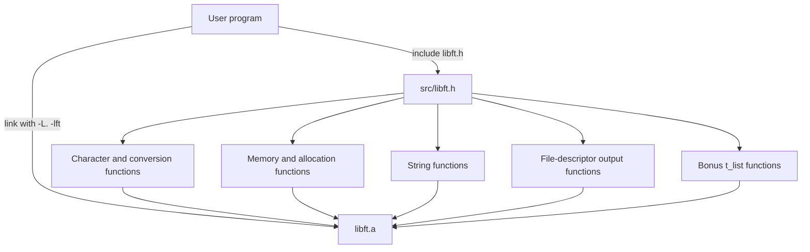

# Libft

A reusable static C library that reimplements a practical subset of the standard C library, created for the [42 curriculum](https://www.42.fr/). The project focuses on low-level memory manipulation, string processing, dynamic allocation, function pointers, and linked-list operations.

The build produces `libft.a`, which can be linked into other C programs.

## Badges

[](https://github.com/A-chem/42-Cursus-Libft)
[](https://www.gnu.org/software/make/)

## Features

- Character classification and case conversion.
- Byte-level memory operations.
- Bounded string copying, concatenation, comparison, and searching.
- Dynamic string creation and transformation.
- Integer-to-string and string-to-integer conversion.
- File-descriptor output helpers.
- Optional generic singly linked-list operations.
- Static-library packaging through `ar`.
- Strict compilation with `-Wall -Wextra -Werror`.

## Tech Stack

- **Language:** C
- **Build system:** GNU Make-compatible `Makefile`
- **Compiler:** `cc`
- **Library format:** Static archive (`libft.a`)
- **Runtime dependencies:** C standard library headers and POSIX `unistd.h`; no third-party dependencies

## Architecture

Libft is organized as a collection of focused C implementations exposed through one public header. The Makefile compiles each source file into an object file and archives the objects into `libft.a`.



### Build flow

1. `cc` compiles the mandatory `.c` files with `-Wall -Wextra -Werror`.
2. The resulting `.o` files are archived into `libft.a` with `ar rcs`.
3. A consuming program includes `src/libft.h`.
4. The linker connects the program to the static library with `-L` and `-lft`.
5. The optional bonus target adds the linked-list object files to the archive.

## Project Structure

```text
.
├── README.md              # Project documentation
├── Subject/
│   └── en.subject.pdf     # English 42 project subject
└── src/
    ├── Makefile           # Build, cleanup, and bonus targets
    ├── libft.h            # Public declarations and t_list definition
    ├── ft_is*.c           # Character classification
    ├── ft_mem*.c          # Memory manipulation and allocation helpers
    ├── ft_str*.c          # String operations and transformations
    ├── ft_atoi.c          # String-to-integer conversion
    ├── ft_itoa.c          # Integer-to-string conversion
    ├── ft_put*_fd.c       # File-descriptor output helpers
    └── ft_lst*_bonus.c    # Bonus singly linked-list operations
```

## Function Reference

All public functions are declared in [`src/libft.h`](src/libft.h).

### Character Classification and Conversion

| Function | Purpose |
| --- | --- |
| `ft_isalpha` | Tests whether a value is an alphabetic character. |
| `ft_isdigit` | Tests whether a value is a decimal digit. |
| `ft_isalnum` | Tests whether a value is alphabetic or numeric. |
| `ft_isascii` | Tests whether a value is in the ASCII range. |
| `ft_isprint` | Tests whether a value is printable. |
| `ft_toupper` | Converts a lowercase letter to uppercase. |
| `ft_tolower` | Converts an uppercase letter to lowercase. |

### Memory and Allocation

| Function | Purpose |
| --- | --- |
| `ft_memset` | Fills a memory region with a byte value. |
| `ft_bzero` | Sets a memory region to zero. |
| `ft_memcpy` | Copies bytes between non-overlapping regions. |
| `ft_memmove` | Copies bytes while supporting overlapping regions. |
| `ft_memchr` | Searches a memory region for a byte. |
| `ft_memcmp` | Compares two memory regions. |
| `ft_calloc` | Allocates zero-initialized memory. |
| `ft_strdup` | Allocates and duplicates a string. |

### String Operations

| Function | Purpose |
| --- | --- |
| `ft_strlen` | Returns the length of a null-terminated string. |
| `ft_strchr` | Finds the first occurrence of a character. |
| `ft_strrchr` | Finds the last occurrence of a character. |
| `ft_strncmp` | Compares up to `n` characters. |
| `ft_strnstr` | Searches for a substring within a bounded region. |
| `ft_strlcpy` | Copies a string with destination-size awareness. |
| `ft_strlcat` | Appends a string with destination-size awareness. |
| `ft_substr` | Allocates a substring. |
| `ft_strjoin` | Allocates the concatenation of two strings. |
| `ft_strtrim` | Removes characters from both ends of a string. |
| `ft_split` | Splits a string into a null-terminated array. |
| `ft_strmapi` | Builds a new string using a callback. |
| `ft_striteri` | Applies a callback to each character in place. |

### Conversion and Output

| Function | Purpose |
| --- | --- |
| `ft_atoi` | Converts the numeric portion of a string to an `int`. |
| `ft_itoa` | Allocates a string representation of an `int`. |
| `ft_putchar_fd` | Writes one character to a file descriptor. |
| `ft_putstr_fd` | Writes a string to a file descriptor. |
| `ft_putendl_fd` | Writes a string followed by a newline. |
| `ft_putnbr_fd` | Writes an integer to a file descriptor. |

### Bonus Linked Lists

The bonus API uses the generic node type declared in `src/libft.h`:

```c
typedef struct s_list
{
    void            *content;
    struct s_list   *next;
} t_list;
```

| Function | Purpose |
| --- | --- |
| `ft_lstnew` | Allocates and initializes a node. |
| `ft_lstadd_front` | Adds a node to the beginning of a list. |
| `ft_lstsize` | Counts list nodes. |
| `ft_lstlast` | Returns the last node. |
| `ft_lstadd_back` | Adds a node to the end of a list. |
| `ft_lstdelone` | Deletes one node using a cleanup callback. |
| `ft_lstclear` | Deletes all nodes and clears the list pointer. |
| `ft_lstiter` | Applies a callback to each node's content. |
| `ft_lstmap` | Builds a transformed list using callbacks. |

## Prerequisites

- A Unix-like environment.
- A C compiler available as `cc`.
- GNU Make or a compatible `make` implementation.

The repository does not define a minimum compiler version, operating-system version, package manager, environment file, database, or external runtime service.

## Installation and Build

Clone the repository and build the mandatory library:

```bash
git clone https://github.com/A-chem/42-Cursus-Libft.git
cd 42-Cursus-Libft/src
make
```

This creates `src/libft.a` and the intermediate object files in `src/`.

To add the bonus linked-list functions, run the mandatory build first and then:

```bash
make bonus
```

The bonus target archives the bonus object files into the existing `libft.a`.

## Makefile Commands

Run these commands from `src/`:

| Command | Description |
| --- | --- |
| `make` | Builds the mandatory functions and creates `libft.a`. |
| `make bonus` | Compiles and archives the bonus linked-list functions. |
| `make clean` | Removes mandatory and bonus object files. |
| `make fclean` | Removes object files and `libft.a`. |
| `make re` | Performs `fclean` followed by a full mandatory build. |

## Usage

Create a C program that includes the public header and link it against the archive. For example:

```c
#include "libft.h"
#include <stdlib.h>

int main(void)
{
    char *message;

    message = ft_strdup("Hello, Libft!");
    if (!message)
        return (1);

    ft_putendl_fd(message, 1);
    free(message);
    return (0);
}
```

From `src/`, compile and link the program:

```bash
cc -Wall -Wextra -Werror main.c -I. -L. -lft -o program
./program
```

Compiler options used above:

- `-I.` searches the current directory for `libft.h`.
- `-L.` searches the current directory for `libft.a`.
- `-lft` links the `libft.a` archive.
- `-o program` names the executable.

If the consuming program is outside `src/`, adjust the include and library paths. For example, from the repository root after building:

```bash
cc -Wall -Wextra -Werror main.c -Isrc -Lsrc -lft -o program
```

## Memory-Management Notes

Several functions allocate memory and return ownership to the caller, including `ft_calloc`, `ft_strdup`, `ft_substr`, `ft_strjoin`, `ft_strtrim`, `ft_split`, `ft_itoa`, and `ft_strmapi`. Check allocation results before use and release returned memory with `free` when it is no longer needed.

`ft_split` returns a null-terminated array whose individual strings and outer array must be freed by the caller. Linked-list cleanup functions accept callbacks so callers can define how node content is released.

## Testing and Code Quality

The repository does not currently include an automated test suite, linter configuration, formatter configuration, or CI workflow. The verified build validation command is:

```bash
cd src
make fclean
make
make bonus
```

The Makefile treats compiler warnings as errors through `-Wall -Wextra -Werror`.

For additional validation, compare behavior with the corresponding standard-library functions and test boundary cases such as empty strings, overlapping memory ranges, allocation failures, and list cleanup. These are suggested checks, not repository-provided test commands.

## API and Runtime Services

This project is a local static library. It does not expose HTTP endpoints, authentication flows, database schemas, network services, Docker configuration, or production deployment manifests.

## Troubleshooting

### `make: command not found`

Install a Make implementation through your operating system's development tools, then verify it with:

```bash
make --version
```

### `cc: command not found`

Install a C compiler toolchain and verify that `cc` is available:

```bash
cc --version
```

### `fatal error: libft.h: No such file or directory`

Compile from `src/` with `-I.` or provide the correct include path, such as `-Isrc` when compiling from the repository root.

### `cannot find -lft`

Build the archive first and ensure the linker search path points to the directory containing `libft.a`:

```bash
cd src
make
```

Then use `-Lsrc -lft` from the repository root or `-L. -lft` from `src/`.

### Bonus functions are unavailable

Build the mandatory library and then run:

```bash
cd src
make bonus
```

## Contributing

Contributions should preserve the small, focused design of the library and the existing compiler requirements.

1. Fork the repository.
2. Create a descriptive branch:

   ```bash
   git checkout -b fix/short-description
   ```

3. Make the change in `src/` and update documentation when the public API changes.
4. Build both mandatory and bonus targets:

   ```bash
   make -C src fclean
   make -C src
   make -C src bonus
   ```

5. Review the diff and commit with a clear message.
6. Push the branch and open a pull request explaining the behavior change and validation performed.

Please do not commit generated `.o` files or `libft.a` unless the project explicitly changes its distribution policy.

## Roadmap

No project roadmap or planned feature list is defined in the repository. Suggested improvements such as automated tests, CI, and a documented license are intentionally not presented as committed plans.

## License

No license file is currently present in the repository. Add a license before distributing or reusing this project outside the intended coursework context.

## Author

**A-chem**

- GitHub: [@A-chem](https://github.com/A-chem)

## Acknowledgments

- [42](https://www.42.fr/) for the Libft project specification and curriculum.
- The official project subject included at [`Subject/en.subject.pdf`](Subject/en.subject.pdf).
